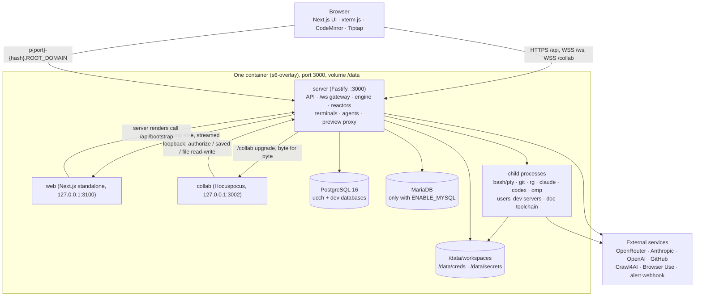
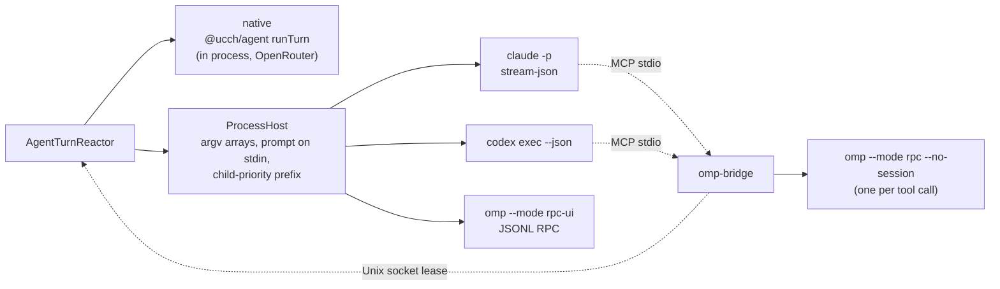

# UCCH architecture

**UCCH (Ultra Chill Coding Harness)** is a self-hosted, browser-based coding workspace. You clone a GitHub repository (or start an empty one), talk to an AI agent that edits it, watch the files, terminal and git change live, preview the running dev server on its own subdomain, and keep notes, tasks, timelines and database tools next to the code.

This document covers the tech stack, how the pieces fit together inside the one container, the data model, and every external system UCCH talks to.

Companion documents:
- [`spec.md`](./spec.md): what each feature does and how it works end to end.
- [`solutions.md`](./solutions.md): the problems that shaped the design, and the solution built for each.
- [`reference.md`](./reference.md): routes, WebSocket frames, commands, events, modules and scripts.

---

## 1. The system at a glance



**The server is the execution boundary.** Every terminal, git command, file read or write, agent turn and dev-server proxy runs in the API server process or a child of it. The browser renders events and diffs. It never executes anything and has no independent model of the world.

**One public port.** The server owns `:3000`. It serves `/api/*`, `/ws`, `/health` and `/metrics`, passes `/collab` upgrades to the collab service, serves `/_next/static/*` and `/sw.js` from disk, and streams every other request to Next.js on loopback (`apps/server/src/web-proxy.ts`). Requests for `p{port}-{hash}.<ROOT_DOMAIN>` are intercepted before Fastify sees them and reverse-proxied to that project's dev server (`apps/server/src/preview.ts`).

---

## 2. Tech stack

| Layer | Technology | Version (from `package.json`) | Used for |
|---|---|---|---|
| Runtime | Node.js | ≥ 22 (`node:22-bookworm-slim` image) | server, web, collab, scripts |
| Package manager | pnpm workspaces | 10.33 | monorepo |
| Language | TypeScript | 5.7 | everything except the doc kit's Python |
| API server | Fastify | 5.2 | HTTP routes, hooks, cookies, rate limits, compression |
| WebSocket | `ws` | 8.18 | the `/ws` gateway |
| Validation | zod | 3.24 | protocol schemas, config, route bodies |
| Database | PostgreSQL 16 + Drizzle ORM (`postgres` driver) | drizzle-orm 0.38, drizzle-kit 0.30 | event log and projections |
| Terminals | `@lydell/node-pty` | 1.2.0-beta.15 | real pseudo-terminals |
| Co-editing | Yjs + Hocuspocus | yjs 13.6.33, `@hocuspocus/server`/`provider` 4.7.1 | notes, files and diagrams edited by several people at once |
| Web framework | Next.js (App Router) + React | Next 15.1, React 19 | the UI |
| Styling | Tailwind CSS v4, shadcn/ui on `@base-ui/react` | Tailwind 4.3, base-ui 1.7 | components and theming |
| Data fetching | TanStack Query | 5.104 | client cache, persisted for recent projects |
| Code editor | CodeMirror 6 + `@replit/codemirror-vim` + `y-codemirror.next` | view 6.43 | file editor, SQL console, diagram source |
| Rich text | Tiptap 3 + `@tiptap/y-tiptap` | 3.31.3 | the documentation (notes) editor |
| Whiteboard | tldraw | 5.4 | whiteboard blocks inside notes |
| Terminal UI | xterm.js | 6.0 | terminal panes |
| Diagrams | Mermaid | 12 | diagram previews (browser) and `mermaid-cli` (server, doc kit) |
| Command palette | cmdk | 1.1 | quick menu, switchers |
| PWA | Serwist (`@serwist/next`) | 9.5.13 | service worker and offline page, behind `NEXT_PUBLIC_PWA=1` |
| MCP | `@modelcontextprotocol/sdk` | 1.32.1 | `omp-bridge` |
| Bundling | esbuild | 0.28 | server, collab and bridge bundles |
| Tests | vitest 2.1, Playwright 1.64 | | unit tests next to the code, e2e in `apps/web/e2e` |
| Process supervision | s6-overlay | 3.2.3.2 | the single container's services |
| Agent CLIs | Claude Code (`claude`), Codex (`codex`), OMP (`omp` 18.14.1) | OMP pinned with SHA-256; the other two are found on `PATH` | agent providers |
| Document toolchain | pandoc 3.6, Typst 0.13.1, LibreOffice Writer, poppler, graphviz, Chromium + mermaid-cli, Python (python-docx, pypdf, pdfplumber, vl-convert) | | Documentation mode |
| Search | ripgrep | (Debian package) | project search, the agent's `grep` |

---

## 3. Monorepo layout

```
apps/server         Fastify API, /ws gateway, engine, reactors, terminals, preview proxy,
                    collab service (second entry point: dist/collab.mjs)
apps/web            Next.js UI
packages/protocol   zod schemas shared by both sides: commands, events, RPC frames, hostnames,
                    roles, permissions; `@ucch/protocol/plain` is the zod-free subset for the browser
packages/db         Drizzle schema, 32 SQL migrations, bootstrap (migrate on boot)
packages/agent      the native agent loop, tool registry, tools, executor, doc kit (doc-kit/)
packages/providers  the provider boundary: Claude Code, Codex and OMP adapters, process host
packages/omp-bridge MCP server that lends OMP's tools to Claude Code and Codex
deploy/             s6 services, init scripts, backup/restore, DB init SQL
scripts/            dev.sh, load-test kit (scripts/load), OMP spike tooling (scripts/omp),
                    pg-top.sh, smoke-container.sh
```

Dependency direction: `protocol` ← `db` ← `agent` / `providers` ← `server`; `protocol` ← `web`; `omp-bridge` ← `providers`. `packages/agent` must not import the database, the event store or Fastify. That boundary is a package edge rather than a convention.

---

## 4. Server internals

### 4.1 Commands, decisions, events

Nothing in the browser writes state. It sends a **command** over the WebSocket; the server decides what happened and appends **events**.

```
client ── dispatch{command} ──▶ WebSocketGateway (scope check: REQUIRED_SCOPE)
                                  │  key = engine.keyOf(command)  (its project, or its own queue)
                                  ▼
                       OrchestrationEngine (KeyedWorker, ENGINE_MAX_PARALLEL lanes)
                                  │  state = #loadState(command)   (thread, project, workspace, membership, turn)
                                  │  events = decide(state, command, ctx)   ← pure function
                                  │  ONE transaction: applyProjection(...) + EventStore.append(...)
                                  ▼
                              EventBus.publish(topic, event)  ──▶ subscribed sockets
                                  │
                                  ▼
                       Reactors (agent turns, worktrees, terminals, audit, reviews…)
                                  └── dispatch more commands / append more events
```

- **`decide()`** (`apps/server/src/decide.ts`) is pure: no database, clock or randomness. Ids, hashes and time come in through `DecisionContext`. Every rule about what the system will and won't do lives there and is tested as a table of (state, command) → events.
- **The engine** (`engine.ts`) runs commands for one project in order and commands for different projects in parallel. `EventStore.append` takes a per-stream lock and assigns project-scoped sequence numbers (`eventstore.ts`).
- **Projections** (`applyProjection`) update the read-model tables (`threads`, `turns`, `project_stats`, `subagents`, …) in the same transaction as the append, so they can never disagree with the log for good.
- **Reactors** do the side effects after the commit and record what actually happened as new events. A decision records intent (`thread.handoff_requested`); the reactor records the outcome (`thread.handed_off` or `thread.handoff_failed`).
- **The bus** (`bus.ts`) is in-process fan-out by topic. A single instance owns the processes, so no broker is needed. Going to several replicas would mean swapping this class for LISTEN/NOTIFY or Redis behind the same interface.

Not everything is event-sourced. Organisation data (workspaces, members, invites, database connections, keys, notes, tasks, timeline tasks, settings) is plain REST over tables. Each successful write is described for the activity log by `route-audit.ts` and announced to other tabs as a `resource.changed` / `*.changed` event, so their caches refetch.

### 4.2 Realtime: the `/ws` gateway

`ws.ts` (`WebSocketGateway`):
1. The browser exchanges its session cookie for a **single-use, short-lived ticket** (`POST /api/ws-ticket`) and opens `/ws?ticket=…&client=<tabId>&caps=…`. A browser can't set headers on a WebSocket handshake, and a long-lived token in a URL would leak into logs.
2. **One socket per tab** carries everything: commands (`dispatch`), subscriptions (`subscribe` to `user`, `workspace`, `project`, `thread`, `terminal`), the shared composer, presence, terminal input and resize, and `ping`.
3. Subscribing to a thread replays its recent events in one batched `replay` frame (with the `replay-batch` capability), then live `push` frames follow.
4. Token deltas are coalesced (`delta-coalescer.ts`, `STREAM_FLUSH_MS` = 40 ms) and only go to the thread topic. A `project` subscription can leave streams out, so a notes page isn't sent every token.
5. Hot frames (deltas, terminal bytes) skip zod on the way in (`terminalFrame`).
6. `revalidate()` re-checks open subscriptions when a membership changes or a session is revoked; a revoked session gets a `revoked` frame.

### 4.3 Agent turns

`AgentTurnReactor` (`agent.ts`) reacts to `user.message` and similar events:
1. **`TurnScheduler`** (`turn-scheduler.ts`) admits the turn or queues it (`agent.queued` tells the thread how many are ahead). Limits: CLI turns per account (`AGENT_MAX_CONCURRENT_PER_USER` = 2), CLI turns in total (`AGENT_MAX_CONCURRENT_TOTAL` = 5), native turns (`AGENT_MAX_NATIVE_TOTAL` = 32) and OMP processes (`OMP_TURN_TOTAL` = 6).
2. It resolves the provider (`resolveProvider`), the model, the permission mode and whose credentials pay (`effectiveCredentialSource`).
3. It runs the turn:
   - **native**: an in-process call to `@ucch/agent`'s `runTurn` over OpenRouter, with the tool registry, context pruning and compaction (`packages/agent/src/loop.ts`, `context.ts`);
   - **claude / codex / omp**: a child process through `ProcessHost`. Its JSONL stream is normalised into the same events (`agent.text_delta`, `agent.tool_use`, `agent.tool_result`, `agent.message`, `agent.turn_completed`, …).
4. Optional phases: research before a CLI turn (`#researchPhase`), retaining facts into OMP memory after one (`#retainAnswer`), automatic handoff when a usage limit is hit (`#handOffOnLimit`), stack re-detection every 5 turns.

### 4.4 Other server subsystems

| Subsystem | Module(s) | What it does |
|---|---|---|
| Auth | `auth.ts`, `password.ts`, `github-admission.ts` | Postgres sessions (cookie), scrypt passwords, GitHub OAuth, WS tickets in memory |
| Access | `access.ts`, `workspace-members.ts` | any member of a project's workspace may open it; role permissions decide each action |
| Files | `files.ts`, `trees.ts`, `confine.ts` | the project's checkout or a session's worktree, path-confined, no symlinks out, no `.git` writes |
| File watching | `file-watcher.ts` | inotify per open tree, coalesced into `file.changed` events |
| Git | `git.ts`, `git-exec.ts`, `git-cache.ts`, `git-routes.ts`, `clone.ts`, `github.ts` | status/diff/log/branches/commit/push/pull/merge, clone with progress, cached reads, token passed by env-based credential helper |
| Sessions and worktrees | `worktrees.ts`, `session-lifecycle.ts` | each session is a git worktree on branch `ucch/{hash}` under `WORKSPACE_ROOT/.worktrees/{projectId}/{hash}` |
| Terminals | `terminals.ts`, `terminal-bridge.ts`, `shell/` | PTY per tab, caps, idle close, shell rc files that wire the OMP bridge into hand-run CLIs |
| Search and replace | `search.ts`, `replace.ts` | ripgrep with structured matches; replace only the ticked ranges that still match |
| Uploads | `uploads.ts` | attachments staged at `WORKSPACE_ROOT/.uploads/{projectId}`, outside every tree |
| Preview | `preview.ts`, `port-watcher.ts` | reverse proxy for `p{port}-{hash}` hosts, preview cookie, static-folder previews, `port.opened/closed` |
| Collab | `collab.ts`, `collab/*`, `collab-link.ts` | Hocuspocus process for notes and files; Yjs ↔ ProseMirror; disk merges |
| Notes, diagrams | `notes.ts`, `notes-routes.ts`, `diagrams.ts`, `mermaid-repair.ts` | documentation pages, Mermaid diagrams generated from the codebase |
| Tasks | `tasks.ts`, `tasks-routes.ts`, `task-pipeline.ts`, `task-scheduler.ts` | Kanban board whose cards an agent carries through research → work → verification |
| Timeline | `timeline.ts`, `timeline-routes.ts` | Gantt tasks with per-field conflict checks (`field-guard.ts`) |
| Databases | `database-connections.ts`, `database-routes.ts`, `db-manager/*`, `dev-database.ts` | saved MySQL/Postgres servers, a phpMyAdmin-style manager, per-project dev databases |
| Keys | `keys.ts`, `keys-routes.ts` | per-project secrets, encrypted at rest |
| Public sites | `public-routes.ts` | read-only notes, files and history at `/shared/{slug}` |
| Providers | `providers.ts`, `quotas.ts`, `openrouter.ts` | credential directories, environments, probes, quota meters, model catalogue |
| OMP | `omp-overlay.ts`, `omp-handoff.ts`, `omp-memory*.ts`, `omp-review.ts`, `omp-bridge-config.ts`, `bridge-leases.ts` | the OMP provider's server half |
| Observability | `metrics.ts`, `resource-sampler.ts`, `watchdog.ts`, `audit.ts` | `/metrics`, per-service memory/CPU, alerts, the activity log |
| Process hygiene | `child-priority.ts`, `worker.ts` | OOM score and nice for children; observable queues |

---

## 5. Web internals

- **Routes** (`apps/web/src/app`): `(app)` holds the signed-in app: `/{workspaceHash}` dashboard, `/code`, `/p/{projectHash}` (chat, `/{sessionHash}`, `documentation`, `tasks`, `timeline`, `keys`, `activity`, `manage`), `/database/...`, `/publish`, `/todo`, `/workspace-settings/...`, `/setting/...`, `/invite/{token}`. Outside it: `/login`, `/shared/{slug}/...` (public sites), `/offline`, `/healthz`, `/file-icons/*`, `/dev/themes`.
- **The shell is a layout** (`app-shell.tsx`): the icon rail, the section panel, the header and the session/workspace resolution render once and stay mounted across navigations.
- **Instant navigation** (`apps/web/CLAUDE.md`): every route has a `loading.tsx` skeleton; layouts await nothing; navigation only goes through `TransitionLink` / `useTransitionRouter`; data changes invalidate queries rather than calling `router.refresh()`. `navigation.test.ts` enforces the mechanical parts.
- **Data**: TanStack Query, with a persisted cache for recent projects. `lib/warmup.ts` and `lib/preload.ts` load a small, fixed set of data once the shell is idle (`route-warmup.tsx`). Pages are never pre-rendered in the background.
- **Realtime** (`lib/realtime.tsx`, `lib/realtime-cache.ts`, `lib/thread-store.ts`): one socket per tab. A cache bridge maps each incoming event to the query keys it invalidates. A client thread store holds durable messages apart from the live streaming tail, so a token re-renders only the tail.
- **Heavy editors are code-split**: CodeMirror plus vim, Tiptap, tldraw, Mermaid and xterm load the first time they're needed (`components/on-demand.tsx`, `CHUNKS`).
- **Browser imports**: client code takes values from `@ucch/protocol/plain` and types from the barrel, so zod isn't shipped to every page.
- **PWA**: manifest and icons always; Serwist service worker and offline page with `NEXT_PUBLIC_PWA=1`; an update toast when `BUILD_ID` changes.
- **Web vitals**: `vitals-reporter.tsx` posts LCP, INP, CLS, TTFB and custom timings to `/api/metrics/vitals`, sampled by `NEXT_PUBLIC_VITALS_SAMPLE_RATE`.

---

## 6. Data model

`events` is the source of truth for project activity. The other project-activity tables are projections maintained in the same transaction (`packages/db/src/schema.ts`). The rest are plain tables.

| Table | Kind | Holds |
|---|---|---|
| `users` | table | accounts: email, name, avatar (URL or `data:`), password hash, GitHub id, encrypted OpenRouter/GitHub/Resend/Claude credentials, default model/provider, agent permission mode |
| `sessions` | table | sign-in sessions (cookie → user), expiry |
| `workspaces` | table | name, hash, kind, logo, archived, `credential_policy`, `agent_settings` (jsonb), dedicated credentials |
| `workspace_members` | table | role (`owner`/`admin`/`member`/`viewer`), `can_create_project`, `can_create_session` overrides |
| `workspace_invites` | table | invite token hash, role, expiry, revocation |
| `projects` | projection | workspace, hash, name, repo URL/branch, detected stack, container state, preview port/folder, public slug, `omp_trusted`, task settings |
| `threads` | projection | sessions/conversations: hash, title, provider, model, status, session token, worktree state, base branch, `tree_hash`, `handoff_from_thread_id`, credential source |
| `events` | **log** | `(stream, seq)` per thread/project, type, JSON payload, timestamp |
| `turns` | projection | one agent turn: provider, model, usage and cost, stop reason, checkpoint shas |
| `project_stats` | projection | per-project counters for the dashboard and sidebars (turns, failures, tokens, cost, last activity) |
| `subagents` | projection | subagents a turn spawned and their results |
| `previews` | projection | published commit previews (defined; nothing builds one yet) |
| `reviews` | table | OMP code reviews: scope, status, verdict, findings |
| `secrets` | table | encrypted per-project environment values |
| `database_connections` | table | a workspace's saved MySQL/Postgres servers (password encrypted) |
| `notes` | table | documentation pages: tree position, title, icon, cover, ProseMirror body, plain text for search |
| `note_ydocs` | table | each note's Yjs state, projected back to `notes` |
| `timeline_tasks` | table | Gantt tasks |
| `project_tasks` | table | Tasks-board cards: stage, status, research, verification, feedback |
| `project_keys` | table | the project's saved keys (encrypted) |
| `audit_log` | table | the activity log: who, what, target, summary, details |

Migrations live in `packages/db/migrations` (32 of them, up to `0031_reviews.sql`) and run on every server boot (`packages/db/src/bootstrap.ts`).

**Disk layout** (in production everything is under `/data`):

| Path | Holds |
|---|---|
| `WORKSPACE_ROOT/{projectId}/` | the project's own checkout |
| `WORKSPACE_ROOT/.worktrees/{projectId}/{treeHash}/` | one session's git worktree |
| `WORKSPACE_ROOT/.uploads/{projectId}/` | staged attachments (`{id}` + metadata), swept after `UPLOAD_TTL_HOURS` |
| `{project}/.agent/` | project knowledge the agents read: `index.md`, `diagrams/*.mmd`, and `env.val` (encrypted environment variables) |
| `CREDS_ROOT/{subject}/claude`, `/codex`, `/omp` | CLI logins (`CLAUDE_CONFIG_DIR`, `CODEX_HOME`, OMP's agent dir), `0700`, per user or `ws-<workspaceId>` |
| `/data/postgres`, `/data/mysql` | embedded database data |
| `/data/secrets` | generated `secret_key`, database passwords, default user password |
| `/data/backups/<timestamp>/` | `ucch-backup` output |

---

## 7. Agent providers



| Provider id | UI name | Runs | Billing | Session continuity |
|---|---|---|---|---|
| `native` | Custom (legacy) | `packages/agent` loop in-process | the account's OpenRouter key | the event log is replayed into context |
| `claude` | Claude Code | `claude -p --output-format stream-json` | the person's (or workspace's) Claude subscription | `--resume <session>` |
| `codex` | Codex | `codex exec --json` | the ChatGPT subscription | `exec resume` (never `--ephemeral`) |
| `omp` | Custom | `omp --mode rpc-ui` | the OpenRouter key | `--resume` with a per-project `--session-dir` |

- **The interface** (`packages/providers/src/types.ts`): every provider normalises into the same event vocabulary, so the UI, revert logic and audit never fork per provider.
- **ProcessHost** (`process.ts`): commands are argv arrays, never shell strings, and the prompt goes on stdin so it never appears in `ps`. Today the processes run on the host, in the workspace directory. A `docker exec` host would implement the same two methods.
- **Billing safety**: `FORBIDDEN_ENV` keeps `ANTHROPIC_API_KEY` and similar out of CLI environments, so a subscription turn can never fall back to a pay-per-token key. OMP gets an explicit allowlist (`OPENROUTER_API_KEY` only), and any other `*_API_KEY` / `*_OAUTH_TOKEN` stops the run from starting (`omp-credentials.ts`).
- **Untrusted repositories don't configure the agents**: `claude --setting-sources user`, `codex --ignore-rules`, and OMP `--no-extensions --no-rules` plus a guard hook and a per-turn overlay. `--no-lsp` and debugging stay off unless the project is marked trusted.
- **OMP** is pinned (18.14.1, `/opt/omp`, SHA-256 checked at build) with its ~120 MB of native modules unpacked once at build time into `PI_NATIVES_DIR`. New "Custom" threads use it only with `OMP_ENABLED=true`. `NATIVE_LOOP_FALLBACK` keeps threads already on the native loop running there.
- **omp-bridge** (`packages/omp-bridge`): an MCP stdio server that gives Claude Code and Codex the tools `omp_task`, `omp_review`, `omp_symbols`, `omp_rename`, `omp_codemod`, `omp_debug`, `omp_recall`, `omp_retain` and `omp_handoff_brief`. Each call is one `omp` process billed to OpenRouter. It takes a slot from the server's scheduler over `UCCH_SCHEDULER_SOCK`, and the call's own guard overlay denies subagents every tool the call didn't ask for.

---

## 8. Deployment

### 8.1 The single container (production)

Built from the `Dockerfile` (stages `base → deps → web-build / server-build → toolchain → app`; the last stage, `app`, is the default). s6-overlay supervises:

| Service | Listens | Notes |
|---|---|---|
| `init-secrets` | | creates any missing `secret_key`, `postgres_password`, `dev_db_password`, `default_user_password` in `/data/secrets`; an env var of the same name wins |
| `init-dirs` | | creates `/data/*` and hands workspaces and creds to `node` |
| `postgres` | `127.0.0.1:5432` | PostgreSQL 16, tuned by `PG_*` vars, `pg_stat_statements` on; skipped when `DATABASE_URL` is set |
| `mysql` | `127.0.0.1:3306` | MariaDB, only with `ENABLE_MYSQL=true` |
| `server` | `0.0.0.0:3000` | the API; reads secrets as root, then drops to `node`; heap `SERVER_HEAP_MB` (1536) |
| `web` | `127.0.0.1:3100` | Next.js standalone; heap `WEB_HEAP_MB` (1024) |
| `collab` | `127.0.0.1:3002` | Hocuspocus; heap `COLLAB_HEAP_MB` (512), `COLLAB_MAX_DOCS` (200) |

- **Dokploy**: an Application built from the Dockerfile (or pulled from GHCR, which `.github/workflows/image.yml` pushes after `ci.yml` passes). Domain `ROOT_DOMAIN` → port 3000, a volume at `/data`, and update order **stop-first**. A start-first rollout would run two Postgres servers on one data directory.
- **Live previews** need a `*.<ROOT_DOMAIN>` DNS record and a wildcard certificate (Traefik DNS-01). See `README.md`.
- **Scaling** is vertical only: one container, one replica. Live terminals, the bus and the processes are in-memory state.
- **Backups**: `ucch-backup` runs `pg_dump` and copies `secret_key` to `/data/backups/<ts>/`, keeping `BACKUP_KEEP` (7). `ucch-restore` restores one.
- **Security model**: everyone who can sign in gets a shell as the container's unprivileged `node` user, so they can read other users' workspaces and CLI logins. Only give accounts to trusted people. Keep `GITHUB_ALLOWED_USERS` / `GITHUB_ALLOWED_ORGS` tight. The Docker socket is not mounted.

### 8.2 Development

`pnpm dev:up` (`scripts/dev.sh`) creates `.env` from `.env.development.example` with a fresh `SECRET_KEY`, installs dependencies, and starts PostgreSQL on `:55432` and MySQL on `:53306` (`docker-compose.dev.yml`). It then runs the server on `:3001`, the web app on `:3000` and collab, with hot reload. `pnpm dev:down` stops the databases. `docker compose up -d --build` runs the production image locally, and `scripts/smoke-container.sh` checks it end to end.

### 8.3 CI

`.github/workflows/ci.yml` runs on every push and PR: `pnpm install`, `pnpm typecheck && pnpm test`, the web build, and `apps/web/scripts/bundle-budget.mjs --check`. `image.yml` builds the `app` target on `main`, pushes `ghcr.io/<owner>/ucch:<sha>` and `:main`, and calls `DOKPLOY_DEPLOY_WEBHOOK` when that secret is set.

---

## 9. External integrations

| System | Purpose | Auth / config | When it's missing or failing |
|---|---|---|---|
| **OpenRouter** | the native loop, OMP turns, the model catalogue (`/api/models`), web search, compaction, handoff briefs, research search (Perplexity Sonar), document vision | the account's (or workspace's) key, encrypted in Postgres; `OPENROUTER_BASE_URL`, `DEFAULT_MODEL`, `SEARCH_MODEL`, `RESEARCH_SEARCH_MODEL`, `DOC_VISION_MODEL` | the turn fails with "add an OpenRouter key"; the quota rail shows no bar |
| **Claude Code CLI** (Anthropic) | Claude Code turns, subscription billed | per-subject `CLAUDE_CONFIG_DIR` from a login in a terminal dialog, or a pasted `CLAUDE_CODE_OAUTH_TOKEN`; `CLAUDE_BIN` | probe reports not installed or not signed in; usage-limit failures can hand off automatically |
| **Codex CLI** (OpenAI) | Codex turns, ChatGPT subscription billed | per-subject `CODEX_HOME` from a device login; `CODEX_BIN` | same as Claude; the UI shows a terms warning that must be acknowledged |
| **OMP (oh-my-pi)** | the "Custom" provider, handoff briefs, code review, memory (mnemopi), bridge tools | OpenRouter key; `OMP_BIN`, `OMP_ENABLED`, `OMP_BRIDGE_BIN`, `OMP_TURN_TOTAL`, `OMP_WORKERS_PER_TURN` | off by default; native loop serves "Custom" |
| **Vendor quota endpoints** | the sidebar's usage meters for Claude, Codex and OpenRouter | the subject's stored credentials | the meter is hidden or says why |
| **GitHub** | OAuth sign-in, repository and branch listing, clone/pull/push credentials | `GITHUB_CLIENT_ID` / `SECRET`, `GITHUB_ALLOWED_USERS` / `ORGS`; a personal token in Settings or the OAuth token | sign-in button hidden; public repositories still clone |
| **Crawl4AI** | research mode's "read" step (pages as Markdown) | `CRAWL4AI_URL`, `CRAWL4AI_API_TOKEN` | the tool tells the model it isn't configured |
| **Browser Use** | research mode's "browse" escalation for gated pages | `BROWSER_USE_API_KEY`, `BROWSER_USE_API_URL` | gated pages are reported instead of browsed |
| **Resend** | stored per account (`PUT /api/settings/resend`) for outgoing email | the account's key | not used by any feature yet |
| **User databases** (MySQL/MariaDB, PostgreSQL) | the database manager, and dev databases for projects | saved connections (encrypted password); `DEV_POSTGRES_URL`, `DEV_MYSQL_URL`, `ENABLE_MYSQL` | the connection test fails at save time |
| **Alert webhook** (ntfy / Slack-compatible) | watchdog alerts | `ALERT_WEBHOOK_URL` | alerts are only logged |
| **Prometheus** (optional) | scraping `/metrics` | `METRICS_TOKEN` (otherwise loopback only) | |
| **tldraw** | whiteboard blocks | build arg `NEXT_PUBLIC_TLDRAW_LICENSE_KEY` | tldraw's own unlicensed behaviour |
| **Cloudflare / Traefik** | DNS and wildcard TLS for previews | Dokploy's Traefik with a DNS-01 resolver | previews unreachable; the rest works |

---

## 10. Configuration

Configuration is validated once at boot by zod (`apps/server/src/config.ts`). A bad value stops the process instead of failing later at request time. The server refuses to start without a way to sign in (a default user, GitHub OAuth or `DEV_AUTH_BYPASS`), and refuses `DEV_AUTH_BYPASS` in production.

| Variable | Default | Meaning |
|---|---|---|
| `NODE_ENV` | `development` | `development` / `production` / `test` |
| `PORT`, `HOST` | `3001`, `0.0.0.0` | the server's listen address (the image uses 3000) |
| `DATABASE_URL` | required | the harness's own Postgres |
| `DEV_POSTGRES_URL`, `DEV_MYSQL_URL` | unset | external servers for projects' dev databases |
| `ROOT_DOMAIN` | `ucch.localhost` | the public domain; previews are `p{port}-{hash}.ROOT_DOMAIN` |
| `PUBLIC_SCHEME` | `http` | `https` in production |
| `PUBLIC_PREVIEW_PORT` | unset | port to put in preview URLs when nothing sits in front (local) |
| `PUBLIC_WEB_ORIGIN` | derived | the origin the browser reaches the web app on |
| `WEB_UPSTREAM`, `WEB_STATIC_DIR` | unset | Next.js upstream and static dir for the single-port proxy |
| `COLLAB_UPSTREAM` | `http://127.0.0.1:3002` | where `/collab` goes |
| `WORKSPACE_ROOT` | `/srv/ucch/workspaces` | project files |
| `CREDS_ROOT` | `/srv/ucch/creds` | CLI logins per subject |
| `SECRET_KEY` | generated in the image | 64 hex chars; AES-256-GCM for stored secrets; collab secret derived from it |
| `DEFAULT_USER_EMAIL`, `DEFAULT_USER_PASSWORD` | unset | seeded once when the email is unused |
| `GITHUB_CLIENT_ID`, `GITHUB_CLIENT_SECRET` | unset | GitHub OAuth |
| `GITHUB_ALLOWED_USERS`, `GITHUB_ALLOWED_ORGS` | unset | who GitHub sign-in admits; both empty = existing accounts only |
| `DEV_AUTH_BYPASS` | `false` | every request is a fixed local user; refused in production |
| `ANTHROPIC_API_KEY` | unset | never passed to CLIs |
| `OPENROUTER_BASE_URL` | OpenRouter's API | |
| `DEFAULT_MODEL` | `anthropic/claude-sonnet-4.5` | when neither the thread nor the account names one |
| `SEARCH_MODEL` | `google/gemini-2.5-flash` | web search reading and compaction |
| `RESEARCH_SEARCH_MODEL` | `perplexity/sonar` | research mode's search step |
| `CRAWL4AI_URL`, `CRAWL4AI_API_TOKEN` | unset | research reader |
| `BROWSER_USE_API_KEY`, `BROWSER_USE_API_URL` | unset | research browser agent |
| `DOC_KIT_DIR`, `DOC_PYTHON`, `DOC_VISION_MODEL`, `DOC_JOBS_MAX` | kit in `packages/agent/doc-kit`, `python3`, `google/gemini-2.5-flash`, `1` | Documentation mode |
| `AGENT_MAX_ITERATIONS` | `25` | native loop hard stop (`stopReason: max_iterations`) |
| `AGENT_ALLOW_HOST_SHELL` | off in production | enables `bash` and the CLI providers in production |
| `AGENT_MAX_CONCURRENT_PER_USER` / `_TOTAL` | `2` / `5` | CLI turn caps |
| `AGENT_MAX_NATIVE_TOTAL` | `32` | native turns and diagram jobs |
| `CLAUDE_BIN`, `CODEX_BIN`, `OMP_BIN` | `claude`, `codex`, `omp` | CLI paths |
| `OMP_ENABLED` | `false` | new Custom threads run on OMP |
| `NATIVE_LOOP_FALLBACK` | `true` | native threads keep running natively |
| `OMP_BRIDGE_BIN` | `/opt/ucch/omp-bridge.mjs` | the bridge bundle |
| `OMP_TURN_TOTAL`, `OMP_WORKERS_PER_TURN`, `OMP_BRIDGE_MAX_SECONDS` | `6`, `4`, `300` | OMP caps |
| `UPLOAD_MAX_BYTES`, `UPLOAD_TTL_HOURS` | 25 MiB, `24` | attachments |
| `METRICS_TOKEN` | unset | bearer token for `/metrics`; unset = loopback only |
| `ALERT_WEBHOOK_URL` | unset | watchdog POST target |
| `LOG_RESOURCE_SAMPLES` | `false` | log every 15 s resource sample |
| `DB_POOL_MAX` | `20` | server pool size |
| `ENGINE_MAX_PARALLEL` | `8` | engine lanes; must be ≤ `DB_POOL_MAX − 4` |
| `CHILD_OOM_ADJ`, `CHILD_NICE` | `800`, `10` | children's OOM score and nice (terminals ≤ 500 / 5) |
| `LOG_LEVEL`, `LOG_SLOW_MS` | `info`/`debug`, `1000` | logging |
| `STREAM_FLUSH_MS` | `40` | delta coalescing window |
| `HISTORY_CACHE_EVENTS` | `20000` | thread events kept in memory for context |
| `TERMINAL_MAX_PER_PROJECT` / `_PER_USER` / `_TOTAL` | `10` / `5` / `40` | terminal caps |
| `TERMINAL_IDLE_MINUTES` | `15` | idle terminals close |

Image and runtime variables read outside `config.ts`: `SERVER_HEAP_MB`, `WEB_HEAP_MB`, `COLLAB_HEAP_MB`, `COLLAB_MAX_DOCS`, `COLLAB_PORT`, `COLLAB_SECRET`, `ENABLE_MYSQL`, `BACKUP_KEEP`, the `PG_*` tuning set, `PG_LOG_MIN_DURATION_MS`. Build arguments: `BUILD_ID`, `NEXT_PUBLIC_PWA`, `NEXT_PUBLIC_TLDRAW_LICENSE_KEY`, `NEXT_PUBLIC_VITALS_SAMPLE_RATE`, `OMP_VERSION`, `OMP_SHA256`. The bridge reads the `UCCH_*` variables listed in `README.md`.

---

## 11. Decisions on record

- **No rewrite in Rust (2026-10-24).** The lag and memory on the 4 vCPU / 8 GB target came from how the system was put together, not from Node.js: pre-rendering 115 pages per sign-in, a global command queue, one WebSocket frame per token, uncapped 372 MB CLI processes, and no limits on children. Of seven causes, only the API process's single thread was about the language. A rewrite (~33k lines, 4–8 months) would have saved about 0.2–0.5 GB. The architectural fixes were made instead ([`solutions.md` §1](./solutions.md#1-performance-on-a-4-vcpu--8-gb-box)). The re-measurement on 2026-10-27 met almost every target, so no Rust component is planned.
- **Containers per project are not built.** The original plan put each project in its own container behind a gateway. What exists is the single container, with processes on the host as the unprivileged `node` user. The `Executor` and `ProcessHost` interfaces are where a Docker implementation would go. See [`spec.md` Open work](./spec.md#open-work).
