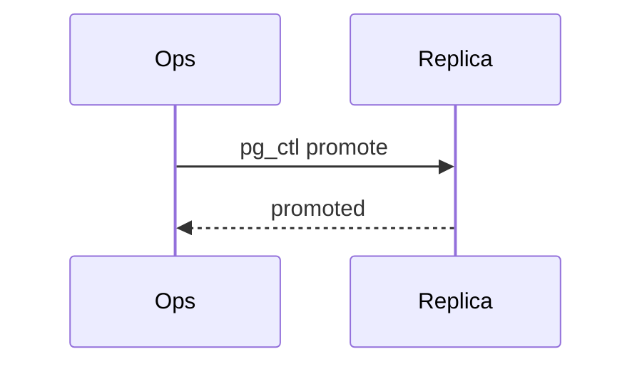

# Structural diagrams

Write a fenced block in the Markdown. doc_render renders it to SVG, places it as a figure, and caches it by content. To render one diagram on its own (to check it, or for a .docx), call `doc_diagram(lang, source, out)`.

````markdown

````

## Which engine

| diagram | engine |
|---|---|
| flowchart, decision tree | Mermaid `flowchart LR` (or `TD` when there are fewer than 6 steps) |
| sequence of calls or messages | Mermaid `sequenceDiagram` |
| state machine | Mermaid `stateDiagram-v2` |
| entity relationships | Mermaid `erDiagram` |
| timeline or schedule | Mermaid `gantt` |
| dependency graph, architecture with many edges | Graphviz `dot` (better automatic layout) |
| a figure that must match the document's fonts exactly | native Typst (see `typst-render`) |

## Readability limits

- **15 nodes or fewer.** Above that, split the diagram by subsystem or by phase. The tool warns you when a diagram is over.
- Keep labels to 4 words or fewer, and put detail in the caption or the prose.
- Choose one direction. Wide content suits `LR` on a portrait page only when there are 5 or fewer steps; otherwise use `TD`.
- Don't use colour to carry meaning by itself; add a label as well.
- Every diagram has a `caption=`; `alt=` is optional and defaults to the caption.

## Errors

Mermaid and Graphviz report the line that failed. Fix the source and render again. Common Mermaid errors:
- Parentheses or quotes inside a node label: wrap the label in `["..."]`.
- `end` used as a node id: rename it.
- Mixed `-->` and `->` in a flowchart.
